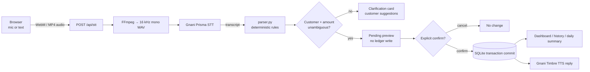

# HisabSetu AI

**Bolo. Likho. Hisaab Rakho.**

A voice-first digital khata (ledger) for Indian kirana shopkeepers. Speak naturally in Hindi, Hinglish or Devanagari — the app transcribes with **Gnani Prisma STT**, parses the customer/amount/intent with a deterministic rule-based parser, shows a confirmation card, and only writes to SQLite after an explicit **Confirm**. Successful replies are spoken with **Gnani Timbre TTS**. The brand line is **HisabSetu AI — Bolo. Likho. Hisaab Rakho.**

> Financial accuracy over flash: no unconfirmed write, no guessed amount, no silently created customer.


---

## What it does

| You say | What happens |
|---|---|
| “Ramesh ko dedh sau rupaye ka udhaar likh do.” | Preview: Ramesh · Udhaar · ₹150 · new balance. Confirm → saved. |
| “Sunita ne do sau rupaye wapas kar diye.” | Preview: Sunita · Payment · ₹200. Confirm → balance reduced. |
| “Mohan ka kitna udhaar baaki hai?” | Spoken + written balance answer from the transaction log. |
| “Sabse zyada udhaar kis customer ka hai?” | Ranked debtors with spoken reply. |
| “Aaj ka poora hisaab batao.” | Today’s credit, payments, net, outstanding, top debtors and reminders. |

The same flow works through the text fallback when a microphone or Gnani key is unavailable.

### Main features

- 🎙️ **Browser recording** with MediaRecorder, live timer, recording indicator, 30-second cap and clear permission/empty-recording handling.
- 🔊 **True audio conversion**: WebM/Opus (Chrome/Edge/Firefox) or MP4/AAC (Safari) is decoded and re-encoded to 16 kHz mono PCM WAV with FFmpeg. Out-of-range WAVs (e.g. Timbre's 48 kHz output) are resampled to 16 kHz for Prisma. A renamed file is never sent.
- 🧠 **Deterministic Hindi/Hinglish parser**: digits, Devanagari numerals, Hindi number words, `dedh`, `dhai`, `sawa`, `paune`, `saade`, `sau`, `hazaar`, `lakh`, and multi-part amounts.
- 🛡️ **Two-step transaction safety**: preview → explicit confirm → atomic SQLite commit. Cancel leaves the ledger untouched. Retries are idempotent.
- 👥 **Customer matching** across Latin and Devanagari names, fuzzy suggestions instead of guessing, and explicit “Naya customer” creation only when the shopkeeper asks.
- 💰 **Overpayment protection**: a payment larger than the outstanding balance requires a second acknowledgement before posting an advance.
- 📊 **Live dashboard** (all figures from SQLite): total outstanding, today’s credit/payments/net, customer ledger with search, transaction history, daily summary, top debtors.
- 🗣️ **Gnani Timbre replies** in natural Hindi with amounts pronounced as Hindi words. TTS failure never blocks the ledger.
- 🧪 **338 automated tests** across parsing, ledger safety, API endpoints, mocked Gnani contracts, the 21-case STT/parser evaluation and real FFmpeg conversion.

---

## Architecture



**Text diagram**

```
mic → MediaRecorder → /api/stt → FFmpeg → Gnani Prisma → transcript
                                                              ↓
                      /api/command → parser.py → customer matching
                                                              ↓
                         pending row (NOT a transaction) → preview card
                                                              ↓
                       confirm ──► atomic transaction insert ──► balance derived
                          └─────► cancel: no ledger change
```

### Ledger rules (documented design)

- **Credit given** (`udhaar`) increases the customer’s outstanding balance.
- **Payment received** (`jama` / `wapas`) decreases it.
- Balances are **never stored on the customer row**. They are always `SUM(credit) − SUM(payment)` over the immutable transaction log. Each transaction also stores an audit snapshot of the balance after posting.
- Amounts are stored as **integer paise**, never floats.
- A transaction row is created only inside the confirmation request, in one DB transaction, after the pending row is atomically claimed (`UPDATE … WHERE status='pending'`).
- `transactions.pending_id` is unique, so duplicate confirms cannot double-post. Re-confirming returns the original transaction with `already_confirmed: true`.
- A pending confirmation expires after 15 minutes.
- Confirming a payment re-checks the balance at commit time. If another payment landed after the preview, the extra acknowledgement is required again.
- Pending previews live in `pending_transactions`; they are **not** part of the ledger.

---

## Project structure

```
voice-khata-ai/
├── main.py                  FastAPI app, routes, error mapping, rate limits
├── config.py                .env settings (secrets never leave the server)
├── database.py              SQLAlchemy engine/session, SQLite pragmas
├── models.py                Customer, Transaction, PendingTransaction
├── schemas.py               Pydantic request/response contracts
├── parser.py                Hindi/Hinglish rule-based parser + name matching
├── services.py              Ledger, proposals, atomic confirmation, summaries
├── money.py                 paise helpers, INR formatting, Hindi number words
├── audio_utils.py           format sniffing, WAV validation, real FFmpeg conversion
├── gnani_client.py          Prisma STT + Timbre TTS REST client
├── seed.py                  8 fictional sample customers (clearly flagged)
├── check_gnani.py           real STT/TTS connectivity checker
├── static/
│   ├── styles.css           mobile-first design system
│   ├── app.js               recording, command flow, confirmation, TTS
│   └── favicon.svg
├── templates/index.html     single-page shopkeeper dashboard
├── tests/
│   ├── conftest.py          isolated SQLite, no key, no network
│   ├── test_parser.py       amounts, intents, names, ambiguity
│   ├── test_ledger.py       balances, confirmation, idempotency, summaries
│   ├── test_api.py          endpoints + mocked voice endpoints
│   ├── test_gnani_client.py mocked HTTP contracts and error handling
│   └── test_audio.py        WAV validation, real WebM → WAV conversion
├── eval_report.py           21-case STT/parser report (offline, fixtures)
├── live_eval.py             TTS → STT round trip over the same 21 phrases (paid)
├── eval_recordings.py       evaluation on real recorded audio (paid)
├── Dockerfile               one-container deploy (Python + ffmpeg)
├── render.yaml              Render blueprint for a free public demo
├── docs/
│   ├── deploy.md            local / Render / Fly.io deployment paths
│   ├── noisy-audio-eval.md  reproducible audio evaluation procedure
│   ├── linkedin-post.md     internship post + 60-second video script
│   └── fix-report.md        what was fixed and how it was verified
├── screenshots/             verification captures
├── requirements.txt
├── pytest.ini
├── .env.example
└── .gitignore
```

---

## Deploy it

Three paths, all documented in [docs/deploy.md](docs/deploy.md):

- **Local + screen recording** — what the internship submission asks for; no
  security surface at all.
- **Render (free, Docker)** — push to GitHub, open the blueprint, paste
  `GNANI_API_KEY` in the dashboard. Free instances sleep and their `/tmp` SQLite
  resets on redeploy (fictional sample data re-seeds); the app is
  unauthenticated, so use it as a demo only and suspend it afterwards.
- **Fly.io with a volume** — same image, persistent `/data/khata.db`.

```bash
# local container
docker build -t hisabsetu .
docker run --rm -p 8000:8000 --env-file .env -v hisabsetu-data:/data hisabsetu
```

`database.py` creates the SQLite folder if it is missing, so a host only needs
one environment variable: `VOICE_KHATA_DB_URL=sqlite:////data/khata.db`.

---

## Prerequisites

- **Python 3.10+** (developed and tested on Python 3.14.2, Windows 11). `py --version` should work; if not, install Python from python.org and tick **“Add python.exe to PATH”**.
- **Windows PowerShell** (commands below). macOS/Linux work too; activate with `source .venv/bin/activate`.
- A modern browser (Chrome, Edge, Firefox or Safari).
- **GNANI_API_KEY** for live voice. The text workflow, parser, ledger and UI work without it.
- **FFmpeg** for WebM/MP4 recordings. `requirements.txt` includes `imageio-ffmpeg`, which ships a real FFmpeg binary, so the demo works without a system install. A system FFmpeg on `PATH` or `FFMPEG_PATH` is also detected.

---

## Windows PowerShell setup

```powershell
# 1. Go to the project folder
cd C:\path\to\voice-khata-ai

# 2. Create and activate a virtual environment
py -m venv .venv
Set-ExecutionPolicy -Scope Process -ExecutionPolicy Bypass
.\.venv\Scripts\Activate.ps1

# 3. Install dependencies
python -m pip install --upgrade pip
python -m pip install -r requirements.txt

# 4. Configure secrets (see next section)
Copy-Item .env.example .env
notepad .env

# 5. Start the server
python -m uvicorn main:app --reload
```

Open **http://127.0.0.1:8000** for the app and **http://127.0.0.1:8000/docs** for interactive API docs.

> If your project path is very long, Windows may fail with `WinError 206` while creating `.venv`. Create it outside the deep folder instead:
> ```powershell
> py -m venv C:\venvs\voice-khata
> C:\venvs\voice-khata\Scripts\Activate.ps1
> ```
> Then continue from step 3 in the project folder.

### Configure `.env`

Copy `.env.example` to `.env` and set:

```dotenv
GNANI_API_KEY=your_real_key_here
GNANI_BASE_URL=https://api.vachana.ai
GNANI_AUTH_HEADER=X-API-Key-ID
GNANI_STT_LANGUAGE=hi-IN
GNANI_STT_PATH=/stt/v3
GNANI_TTS_PATH=/api/v1/tts/inference
GNANI_TTS_MODEL=timbre-v2.5
GNANI_TTS_VOICE=Nalini
GNANI_TTS_LANGUAGE=hi-IN
```

- `.env` is ignored by Git. The key is read only on the server and never returned to the browser, logged, or included in error messages.
- `.env.example` contains placeholders only.
- The voice/model names must belong to the same Timbre model family. Defaults follow the current docs (`timbre-v2.5` + `Nalini`). If you use `timbre-v3.0`, choose a voice documented for v3 and update both variables.
- If your Gnani account documents a different gateway or auth scheme, override `GNANI_BASE_URL`, `GNANI_AUTH_HEADER` and `GNANI_AUTH_SCHEME` — no code change needed.

### Start the server

```powershell
python -m uvicorn main:app --reload
# or bind explicitly
python -m uvicorn main:app --host 127.0.0.1 --port 8000 --reload
```

On first start, SQLite creates `voice_khata.db` and seeds **8 fictional sample customers**. The UI shows a “Sample data” badge. To reset the demo, stop the server, delete `voice_khata.db`, and start again.

---

## Run the tests

```powershell
python -m pytest
```

- The suite uses a throwaway SQLite database, forces `GNANI_API_KEY` empty, and mocks all Gnani HTTP calls.
- **No API key and no API charges are needed.**
- Actual result in this workspace: **338 passed, 1 warning** (a Starlette/FastAPI deprecation notice about `httpx` in `TestClient`).
- The WebM conversion test **really encodes a WebM/Opus file with FFmpeg** and asserts the output is a 16 kHz mono PCM WAV.

Focused runs:

```powershell
python -m pytest tests/test_parser.py -q
python -m pytest tests/test_ledger.py -q
python -m pytest tests/test_api.py -q
python -m pytest tests/test_stt_parser_evals.py -q
```

---

## Evaluation: what is measured, and what is not

Three scripts, three different kinds of evidence. Do not mix their numbers.

| Script | Input | Cost | What it proves |
|---|---|---|---|
| `eval_report.py` + `tests/test_stt_parser_evals.py` | 21 supplied transcripts | free, offline | parser behaviour on fixed text — **not** microphone accuracy |
| `live_eval.py` | TTS-synthesized Hindi speech | 1 Gnani call per case | the whole chain works on *synthetic* speech |
| `eval_recordings.py` | your own recordings | 1 Gnani call per clip | the only tier that can measure real-world speech |

```powershell
# Parser report over the 21 supplied transcripts (writes report.md / report.csv)
python eval_report.py --markdown report.md --csv report.csv

# Live round trip: TTS -> Prisma STT -> parser, all 21 phrases (paid)
python live_eval.py --markdown live_report.md

# Real recordings: name files <case_id>__<condition>.<ext>, e.g. 13__noisy.m4a
python eval_recordings.py --list                 # phrases to record, no API calls
python eval_recordings.py --dir recordings\      # paid, one request per clip
```

The full procedure — recording conditions, file naming, FFmpeg noise overlay,
and the rules for reporting the numbers honestly — is in
[docs/noisy-audio-eval.md](docs/noisy-audio-eval.md).

Current results on the supplied transcripts: **21/21** parse to a command,
**19/21** reproduce the intended command exactly, **2/21** diverge only because
the supplied transcript lost the command (cases 1 and 4), and **0** failures are
attributable to the parser. No real-recording accuracy has been measured, so none
is claimed.

---

## Check Gnani connectivity for real

`check_gnani.py` makes live API calls. It needs a real key and a sample recording (or use `--roundtrip`, which synthesizes Hindi speech with Timbre and feeds it back into Prisma — no recording required).

```powershell
# Speak a phrase and save the TTS result
python check_gnani.py --tts "नमस्ते, वॉइस खाता ए आई में आपका स्वागत है।"

# Transcribe your own WAV/MP3/OGG/M4A recording
python check_gnani.py --audio samples\udhaar.wav

# TTS → STT round trip (tests both services)
python check_gnani.py --roundtrip
```

How to obtain a sample recording without any privacy risk: record yourself saying “Ramesh ko dedh sau rupaye ka udhaar likh do” for 3–5 seconds (Windows Voice Recorder → save as `.wav`), or use `--roundtrip`. The repository intentionally ships **no real voices or customer data**.

Without a key the script prints setup instructions and exits with code 2 — it never fakes success.

### Verified Gnani integration (current official docs, checked 26 Oct 2026)

Sources: [docs.gnani.ai](https://docs.gnani.ai), [llms.txt index](https://docs.gnani.ai/llms.txt), [STT REST](https://docs.gnani.ai/api/STT/speech-to-text), [TTS REST](https://docs.gnani.ai/api/TTS/tts-inference), [quick start](https://docs.gnani.ai/api/introduction/quick-start).

| Item | Implemented value |
|---|---|
| Base URL | `https://api.vachana.ai` |
| Auth header | `X-API-Key-ID: <key>` (no Bearer scheme in the developer docs) |
| Prisma STT | `POST /stt/v3`, `multipart/form-data` |
| STT fields | `audio_file` (WAV/MP3/OGG/FLAC/AAC/M4A), `language_code` (`hi-IN`, `en-IN`, …), `format=verbatim` |
| STT response | JSON with top-level `transcript`, `request_id`, optional `model` |
| Timbre TTS | `POST /api/v1/tts/inference`, JSON body |
| TTS body | `text`, `voice`, `model`, `language`, `speed`, `audio_config` (`wav`, `linear_pcm`, 48 kHz, mono, 16-bit) |
| TTS response | Binary audio (`audio/wav`), not JSON |
| Duration limits | Recording capped at 30 s in the UI; WAV up to 60 s accepted server-side |

Gnani models used: Prisma STT and Timbre TTS — exact model versions and voices are documented in the implementation according to the current official API configuration.

Defaults in this implementation: Prisma (`hi-IN`), Timbre `timbre-v2.5` with voice `Nalini` (`hi-IN`), configurable in `.env`. The docs also list `timbre-v3.0`; voices are model-specific.

> The official Gnani marketing page shows a different, older `api.gnani.ai` + `Authorization: Bearer` example. The developer documentation (used here) specifies `api.vachana.ai` + `X-API-Key-ID`. Both host and auth header/scheme are configurable, so a key provisioned for another gateway can be used without editing code.
>
> **Live verification (one request each, 30 Oct 2026):** Timbre TTS returned
> 230,444 bytes of `audio/wav` (verified `RIFF`/`WAVE` header) for
> “रमेश को डेढ़ सौ रुपये का उधार लिख दो”, and Prisma STT on that same audio
> returned that sentence back verbatim (`prisma-v2.5`). Both calls used the
> documented formats above. A single smoke test is not an accuracy measurement;
> the mocked contract tests cover the error paths, and `check_gnani.py` is the
> repeatable real-call tool.

### Compound commands and corrections

- Two clearly separated instructions in one utterance (“Ramesh ko 200 udhaar
  **aur** Sunita ne 200 jama kiye”) are **never** split automatically: the app
  lists the commands it heard and asks you to say them one at a time, so each
  financial action gets its own preview and its own Confirm. Nothing is dropped
  silently.
- The transcript card has **Transcript sudharein**: it loads the words into the
  text box so a misheard name or amount can be fixed; sending it re-parses and
  rebuilds the preview. The confirmation card's **Details theek karein** form
  edits customer, type and amount and also rebuilds the preview.
- Neither correction path writes to the ledger. Only **Confirm** on the rebuilt
  preview saves, and a superseded preview can never be confirmed afterwards.
- Re-sending the *identical* instruction supersedes the earlier identical
  preview, so a double-tap on “Bhejein” cannot post the same entry twice.

### Voice failure behaviour

Status contract for the two voice endpoints (each row is covered by tests):

| Endpoint | Status | Meaning |
|---|---|---|
| `/api/tts` | `200` | real audio bytes, `content-type` from the provider (`audio/wav`) |
| | `422` | reply text empty or longer than `MAX_TTS_CHARS` (400) |
| | `429` | local rate limit |
| | `502` | provider/network failure (`gnani_*` code) |
| | `503` | `GNANI_API_KEY` missing (`gnani_not_configured`) |
| `/api/stt` | `200` | transcript with provider metadata |
| | `415`/`422` | unsupported/empty audio, or FFmpeg needed for WebM |
| | `502` | provider/network failure |
| | `503` | `GNANI_API_KEY` missing (`gnani_not_configured`) |

A `200` from `/api/tts` is never returned unless the provider actually handed
back audio (an error JSON body is rejected and surfaced as `502`).

- STT not configured → HTTP 503 with a setup card in the UI; text input remains fully usable.
- Gnani 401/403 → “API key accept nahi hui”; the key is redacted from any provider message.
- 429 → “rate limited”; 5xx → service error; timeouts/network → actionable message.
- Empty/unsupported audio → 422/415 with mic or FFmpeg guidance.
- TTS failure → reply text stays on screen and the ledger workflow continues; nothing is rolled back.
- **No financial transaction is ever reported as successful before the database commit.**

---

## API

| Method | Path | Purpose |
|---|---|---|
| `GET` | `/api/health` | DB status, Gnani configuration, FFmpeg availability (never secrets) |
| `GET` | `/api/dashboard` | Outstanding, today’s credit/payments/net, counts |
| `GET` | `/api/customers?search=` | Customers with derived balances |
| `POST` | `/api/customers` | Explicitly add a customer (duplicate/invalid names rejected) |
| `GET` | `/api/customers/{id}` | One customer + latest transactions |
| `GET` | `/api/transactions?limit=&customer_id=` | Transaction history |
| `POST` | `/api/stt` | Upload audio → converted WAV → Gnani Prisma transcript |
| `POST` | `/api/command` | Parse text/transcript → proposal, clarification or answer |
| `POST` | `/api/manual-proposal` | Correct details by hand; still previews before saving |
| `GET` | `/api/pending/{id}` | Pending confirmation status |
| `POST` | `/api/pending/{id}/confirm` | Atomically post exactly once (idempotent) |
| `POST` | `/api/pending/{id}/cancel` | Cancel with no ledger impact |
| `POST` | `/api/tts` | Gnani Timbre WAV reply |
| `GET` | `/api/daily-summary?date=YYYY-MM-DD` | IST daily summary + reminders |
| `GET` | `/api/top-debtors?limit=` | Highest outstanding balances |

Errors use one shape:

```json
{"error": {"code": "overpayment_ack_required", "message": "...", "hint": "..."}}
```

---

## Parser coverage

**Amounts**

| Phrase | Value |
|---|---|
| `dedh sau` | ₹150 |
| `dhai sau` / `ढाई सौ` | ₹250 |
| `sawa do sau` | ₹225 |
| `paune do sau` | ₹175 |
| `saade do sau` / `saade teen sau` | ₹250 / ₹350 |
| `paanch hazaar` | ₹5,000 |
| `do hazaar paanch sau` | ₹2,500 |
| `ek lakh pachaas hazaar` | ₹1,50,000 |
| `150 rupaye`, `₹500`, `1,50,000`, `पांच हज़ार` | numeric forms |

**Intents**: `add_credit`, `record_payment`, `balance_query`, `top_debtor`, `daily_summary`, `unknown`.

Context matters: “Mohan **ne** paise de diye” is a payment, while “Mohan **ko** paise de diye” is credit. “udhaar likh **do**” does not read `do` as ₹2. A query plus a transaction in one sentence is flagged as ambiguous instead of guessing. The parser never writes to the database and never uses an LLM for arithmetic.

**Customers**: exact normalized matching (case, honorifics, Devanagari transliteration), fuzzy suggestions for typos, multiple matches offered as choices, and no automatic creation. A name is only added through the explicit “Naya customer” action.

---

## Demo script (2–3 minutes)

1. Open the dashboard at `http://127.0.0.1:8000`. Point out the total outstanding, today’s credit/payments and the sample-data badge.
2. Click the mic and say: **“Ramesh ko dedh sau rupaye ka udhaar likh do.”**
3. Show the transcript card: the exact words plus parsed intent, amount and customer with confidence.
4. Show the confirmation card: Customer, Udhaar, ₹150, current balance → new balance, and the note “Ledger abhi nahi badla hai.”
5. Click **Confirm transaction**. Show the success card and the updated total/customer balance/history.
6. Ask by voice/text: **“Ramesh ka kitna udhaar baaki hai?”** Show the balance card. If Timbre is configured, press **Sunao** to play the Hindi reply.
7. Ask: **“Sabse zyada udhaar kis customer ka hai?”**
8. Open/ask for **“Aaj ka poora hisaab batao”** and show credit, payments, net, outstanding, top debtors and reminders.
9. Optional safety demo: say **“Sunita ne ek hazaar rupaye wapas kar diye”** when her balance is ₹150. Show the overpayment warning and the second confirmation step. Then press **Cancel** and show the ledger is unchanged.

### Test phrases

| Phrase | Expected |
|---|---|
| `Ramesh ko dedh sau rupaye ka udhaar likh do` | credit ₹150 |
| `Sunita ne do sau rupaye wapas kar diye` | payment ₹200 |
| `Mohan ka kitna udhaar baaki hai?` | balance answer |
| `Sabse zyada udhaar kis customer ka hai?` | ranked debtors |
| `Aaj ka poora hisaab batao.` | daily summary |
| `Ramesh ko paune do sau ka udhaar likh do` | credit ₹175 |
| `सुनीता ने दो सौ रुपये वापस कर दिए` | payment ₹200 |
| `Ramessh ko 500 udhaar` | clarification with Ramesh suggestion |
| `Ramesh ko udhaar likh do` | asks for the amount |
| `Ramesh ko 0 rupaye udhaar` | rejected: amount must be positive |
| `Ramesh ko 150 aur Sunita ko 200 udhaar` | rejected as ambiguous |

---

## Common problems

| Symptom | Fix |
|---|---|
| `python` opens the Microsoft Store / not found | Install Python from python.org with “Add to PATH”, or use `py` instead of `python`. |
| `Activate.ps1 cannot be loaded` | `Set-ExecutionPolicy -Scope Process -ExecutionPolicy Bypass`, then activate again. |
| `WinError 206` / path too long during `venv` | Create the venv outside the deep folder (see setup note) or enable Windows long paths. |
| Mic permission denied | Click the mic/lock icon in the address bar → Allow. Use `http://127.0.0.1:8000` or `localhost`. Also check Windows → Settings → Privacy → Microphone. |
| “Is browser mein microphone recording support nahi” | Use Chrome/Edge/Firefox/Safari, or the text box. Recording requires a secure context; localhost counts as secure. |
| `ffmpeg_missing` / conversion needed | `pip install imageio-ffmpeg` (already in requirements), or `winget install Gyan.FFmpeg`, then restart the terminal/server. Check the Setup card: FFmpeg should be green. |
| Uploaded WebM rejected with 415 | The server could not identify/convert it. Record again in the app; upload WAV/MP3/OGG/M4A/FLAC directly if needed. |
| Gnani 401/403 | Wrong/expired key, or wrong gateway. Fix `GNANI_API_KEY`/`GNANI_BASE_URL` and restart the server. The key is never printed. |
| Gnani “kuch samajh nahi aaya” | Quiet/empty recording or unsupported audio. Record 2–10 seconds, speak clearly, keep the clip under 30 seconds. |
| Timbre error but text reply present | TTS is optional for correctness; the transaction remains saved and the text reply is shown. Check the TTS model/voice pair. |
| `[Errno 10048] address already in use` | Another server is on port 8000. Use `--port 8001` or stop the other process. |
| Hindi text looks garbled in the terminal | Use Windows Terminal / PowerShell 7, or set `$env:PYTHONUTF8 = "1"`. The web UI renders Devanagari correctly regardless. |
| `zoneinfo` / `Asia/Kolkata` error | `pip install tzdata` (already in requirements) and restart. |
| `ImportError: DLL load failed while importing _collections_cy: An Application Control policy has blocked this file` | Windows Application Control / Smart App Control blocked SQLAlchemy's compiled helpers. They are optional: rename them and SQLAlchemy falls back to pure Python — `cd .venv\Lib\site-packages\sqlalchemy; Get-ChildItem -Recurse *.pyd | Rename-Item -NewName { $_.Name + '.blocked' }` — then re-run the tests. Nothing in the app changes. |

---

## Known limitations

- **Single-shop, local, unauthenticated app.** It binds to localhost in the documented commands. Do not expose it to the internet without adding authentication and HTTPS.
- **No customer/transaction edit or delete UI.** The ledger is append-only by design; corrections are new entries. Customers can be added but not renamed or removed.
- **Rule-based parser, not an LLM.** It is predictable and testable but limited to the documented vocabulary/grammar. Unusual dialects, code-mixed English amounts, or multiple transactions in one sentence produce a clarification instead of a guess.
- **No streaming STT.** One short recording per command (UI cap 30 s; server accepts up to 60 s).
- **No automatic messages.** Reminders are suggestions shown to the shopkeeper only; no SMS/WhatsApp is sent.
- **In-memory TTS cache** (per server process, max 12 replies). Audio is not persisted.
- **Sample data stays until reset.** Delete `voice_khata.db` to start clean; first run seeds again.
- **Live Gnani verification is a smoke test only.** One real TTS and one real STT request succeeded in this workspace (see above); that proves the wire format, not accuracy. No real-recording evaluation has been run — use `eval_recordings.py` and report the tier honestly. Do not read the green “FFmpeg” status as Gnani being configured.
- **Amount limits:** one transaction up to ₹1,00,00,000 (1 crore), amounts stored as integer paise. Payment larger than the balance posts an advance only after acknowledgement.
- **Timezone:** day boundaries use `Asia/Kolkata` (IST). Server and browser clocks should be roughly correct.
- **Local SQLite** is perfect for one shop; it is not a multi-device cloud database.

### What is fully working vs. needs credentials

| Area | Status |
|---|---|
| Dashboard, ledger, balances, search, history | ✅ Fully working (SQLite) |
| Text commands in Hindi/Hinglish/Devanagari | ✅ Fully working |
| Confirmation, cancel, idempotency, overpayment guard | ✅ Fully working + tested |
| Daily summary, top debtors, reminders | ✅ Fully working (IST) |
| Customer creation and fuzzy matching | ✅ Fully working |
| WebM/MP4 → WAV conversion | ✅ Working with FFmpeg (tested with a real encoded WebM) |
| Browser recording UI | ✅ Implemented; needs a mic + permission |
| Gnani Prisma transcription | ✅ Verified live once (30 Oct 2026); requires `GNANI_API_KEY` |
| Gnani Timbre spoken replies | ✅ Verified live once (230 KB WAV); text reply always available |
| Compound-command detection + correction flows | ✅ Fully working + tested |
| Real-recording accuracy | ⚠️ Not measured. Run `python eval_recordings.py --dir recordings\` on your own clips. |

---

## Internship post (ready to publish)

The challenge asks for a **public video post** on LinkedIn or X, tagging **Gnani**
and carrying `#GnaniAI` + `#GreatIndianAIInternshipChallenge`. Nothing is posted
automatically.

The final post text, the 60-second video shot list, alt text, the first comment
with technical details, an X variant and a pre-post checklist are in
[docs/linkedin-post.md](docs/linkedin-post.md).

> 🎙️ **HisabSetu AI — बोलिए, हिसाब लिख जाएगा।**
>
> Kirana shopkeepers already know how to speak their ledger. Now the app can too.
> Udhaar, jama, balance and daily hisaab in Hindi/Hinglish — with a confirmation card before anything is saved.
>
> Built with Gnani Prisma (STT) and Timbre (TTS). Ledger accuracy first: no
> silent guesses, no unconfirmed writes, no invented metrics.
>
> #GnaniAI #GreatIndianAIInternshipChallenge #Hinglish #VoiceAI #BuildInPublic

**Honesty note:** the post quotes only what the repository can back up — 337
tests, a 21-case evaluation suite (19/21 exact, 0 parser failures) and one live
Prisma+Timbre round trip. It claims no award, benchmark, user count or
real-world accuracy.

---

## Third-party services and privacy

- **Gnani AI** — Prisma STT and Timbre TTS. Audio you record is sent to Gnani for transcription; reply text is sent to Gnani for speech synthesis. Review Gnani’s terms and data policy before using real customer names.
- The app stores only customer display names, transaction amounts, timestamps, transcripts/source and audit fields. It stores **no phone numbers, Aadhaar, PAN, addresses or recordings**.
- Sample customers are fictional. Reminders are never sent to customers.
- The server keeps `GNANI_API_KEY` in `.env` and never includes it in responses, logs or browser code.

---

## License

Built for the Gnani AI internship challenge. Add your preferred license before redistributing.
